# Module 09 — Grafana Kubernetes Monitoring Dashboard

> **Project:** Prometheus + Grafana Kubernetes Monitoring
> **Environment:** Kubernetes / Minikube + kube-prometheus-stack + Grafana
> **Purpose:** Build and document a practical Kubernetes monitoring dashboard using Prometheus metrics and PromQL.

---

## 1. Objective

The objective of this module is to use Grafana to visualize the Kubernetes metrics already collected by Prometheus.

The monitoring flow developed in this project is:

```text
Kubernetes
    ↓
kube-state-metrics / node-exporter
    ↓
Prometheus
    ↓
Grafana Prometheus Data Source
    ↓
Grafana Explore
    ↓
Kubernetes Monitoring Dashboard
    ↓
Dashboard Panels
    ↓
Grafana Alerting
    ↓
Email / Gmail Notifications
```

Grafana is therefore the visualization layer on top of the Prometheus metrics already explored and tested in the previous modules.

---

## 2. What Was Already Completed Before Dashboard Creation

Before creating the dashboard, the following were verified:

- Grafana is running in the `monitoring` namespace.
- Grafana was accessed through port-forwarding on port `3000`.
- Prometheus was already configured as a Grafana data source.
- Prometheus was marked as the default data source.
- The `up` query returned monitored targets.
- `kube_pod_info` returned Kubernetes Pod information.
- `count(kube_pod_info)` returned the Pod count at the time of testing.
- Kubernetes metrics were available through kube-state-metrics.

The verified architecture was:

```text
Kubernetes
    ↓
kube-state-metrics
    ↓
Prometheus
    ↓
Grafana
```

### Grafana Data Source

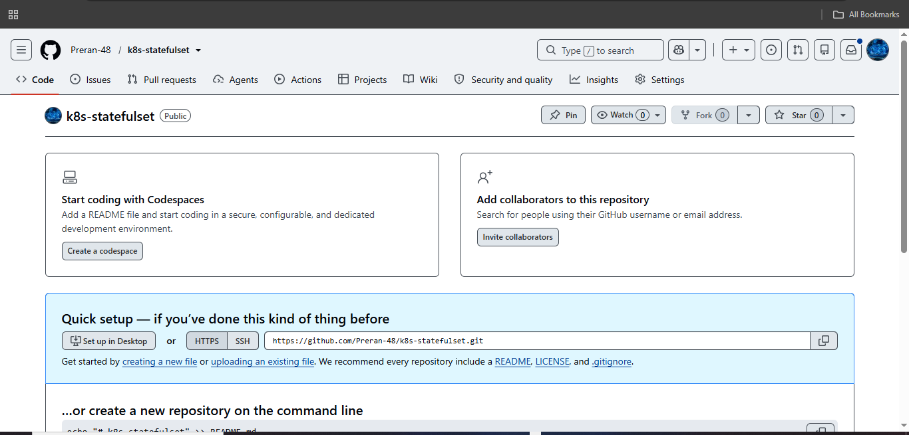

The Prometheus endpoint used by Grafana was:

```text
http://monitoring-kube-prometheus-prometheus.monitoring:9090/
```

### Grafana Explore — Prometheus Connectivity

The first connectivity test used:

```promql
up
```

This verified that Grafana could query Prometheus and receive target status.

### Grafana Explore — Kubernetes Metrics

The Kubernetes metric test used:

```promql
kube_pod_info
```

The Pod count test used:

```promql
count(kube_pod_info)
```

At the time of the recorded test, the result was `15`. The value is not fixed; it changes with cluster state.

---

# 3. Creating the Kubernetes Monitoring Dashboard

The dashboard was created manually rather than importing a ready-made dashboard.

Dashboard name:

```text
Kubernetes Cluster Monitoring
```

The dashboard was built from PromQL queries that had already been studied and tested.

A panel generally consists of:

```text
Prometheus Data Source
        +
      PromQL
        +
 Visualization
        =
   Grafana Panel
```

The dashboard developed during this project contains the Kubernetes monitoring panels documented below.

---

# 4. Dashboard Panel 1 — Total Pods

## Purpose

Displays the current total number of Kubernetes Pods represented by the `kube_pod_info` metric.

## PromQL

```promql
count(kube_pod_info)
```

## Visualization

```text
Stat
```

## Explanation

`kube_pod_info` exposes information about Kubernetes Pods.

`count()` counts the returned time series:

```text
kube_pod_info
      ↓
    count()
      ↓
Total Pods
```

## Screenshot

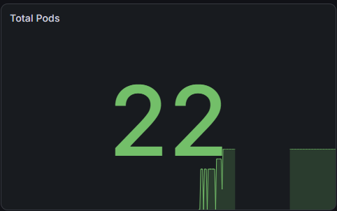

---

# 5. Dashboard Panel 2 — Running Pods

## Purpose

Shows how many Kubernetes Pods are currently in the `Running` phase.

## Metric

```promql
kube_pod_status_phase
```

## Running-Pod filter

```promql
kube_pod_status_phase{phase="Running"}
```

The recorded Prometheus testing showed individual Pod series with value `1` for the Running phase.

For a count-oriented panel, the Running series can be aggregated to obtain the number of Running Pods.

## Visualization

```text
Stat
```

## Screenshot

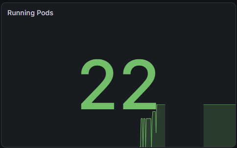

---

# 6. Dashboard Panel 3 — Pods by Namespace

## Purpose

Shows the distribution of Kubernetes Pods across namespaces.

The dashboard displayed namespaces such as:

```text
default
kube-system
monitoring
```

## Metric

```promql
kube_pod_info
```

The dashboard uses the `namespace` label to group Pod information.

Conceptually:

```text
kube_pod_info
      ↓
namespace label
      ↓
group Pods
      ↓
Pods by Namespace
```

## Visualization

```text
Bar chart
```

## Screenshot

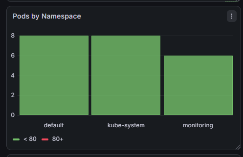

---

# 7. Dashboard Panel 4 — Pod Ready Status

## Purpose

Shows the current Pod readiness distribution.

The panel displayed readiness states such as:

```text
true
false
unknown
```

## Metric

```promql
kube_pod_status_ready
```

To investigate Pods that are not ready:

```promql
kube_pod_status_ready{condition="false"} == 1
```

This same metric later became the basis of the Kubernetes Pod Not Ready alert.

## Visualization

```text
Bar chart
```

## Screenshot

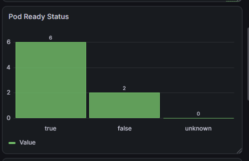

---

# 8. Dashboard Panel 5 — Pod Restart Count

## Purpose

Shows restart activity for Kubernetes Pods/containers.

## Metric

```promql
kube_pod_container_status_restarts_total
```

This metric is a counter.

Therefore, when we want restart activity over a period, `increase()` is useful.

Example:

```promql
increase(
  kube_pod_container_status_restarts_total[5m]
)
```

A practical project test also used:

```promql
increase(
  kube_pod_container_status_restarts_total{
    namespace="default",
    pod="restart-demo"
  }[5m]
) > 1
```

## Visualization

```text
Bar chart
```

## Screenshot

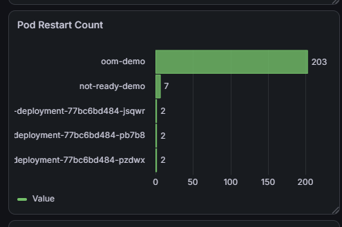

The screenshot also demonstrates that a Pod such as `oom-demo` can accumulate a high restart count during a failure scenario.

---

# 9. Dashboard Panel 6 — CPU Usage by Namespace

## Purpose

Shows CPU usage grouped by Kubernetes namespace.

## Metric

```promql
container_cpu_usage_seconds_total
```

This is a counter, so CPU usage is calculated using `rate()`.

## Query Used in the Panel

The captured Grafana panel configuration showed:

```promql
sum(
  rate(container_cpu_usage_seconds_total[5m])
) by (namespace)
```

## Explanation

```text
container_cpu_usage_seconds_total
              ↓
            rate()
              ↓
          sum by namespace
              ↓
      CPU Usage by Namespace
```

## Visualization

```text
Bar chart / Time series
```

## Screenshot

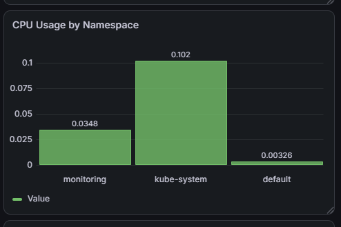

A captured Grafana panel-edit screenshot also showed this query being used directly in the dashboard.

---

# 10. Dashboard Panel 7 — Memory Usage by Namespace

## Purpose

Shows memory usage grouped by Kubernetes namespace.

## Metric

```promql
container_memory_working_set_bytes
```

This metric represents the working-set memory used by containers.

The dashboard displayed memory usage for namespaces including:

```text
monitoring
kube-system
default
```

## Visualization

```text
Bar chart
```

## Screenshot

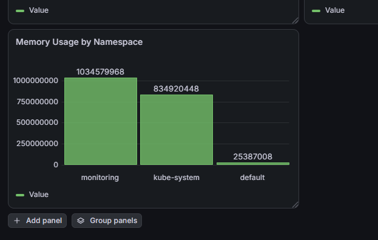

> The screenshot records the actual dashboard result. The exact aggregation expression is intentionally not reconstructed here when it was not visible in the captured panel configuration.

---

# 11. Dashboard Panel 8 — Top CPU-Consuming Pods

## Purpose

Helps identify Pods consuming the most CPU.

## Metric

```promql
container_cpu_usage_seconds_total
```

Because this is a counter, CPU consumption should be calculated using `rate()`.

## Captured Panel Query

The Grafana panel configuration captured during the project showed:

```promql
sum(
  rate(container_cpu_usage_seconds_total[5m])
) by (pod)
```

The panel was titled:

```text
Top 5 CPU-Consuming Pods
```

## Important Troubleshooting Point

During panel creation, the raw metric was also tested:

```promql
container_cpu_usage_seconds_total
```

Grafana correctly identified it as a counter and suggested calculating its rate.

This was an important practical lesson:

```text
Counter
   ↓
rate()
   ↓
CPU usage
```

## Visualization

```text
Bar chart
```

## Screenshot

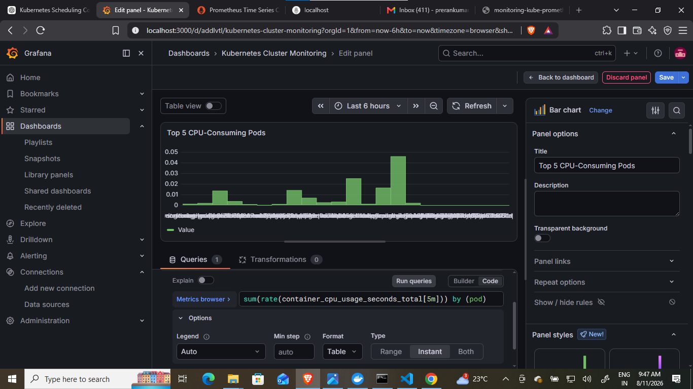

---

# 12. Dashboard Panel 9 — Top Memory-Consuming Pods

## Purpose

Identifies Pods consuming the most memory.

## Metric

```promql
container_memory_working_set_bytes
```

The panel was titled:

```text
Top 5 Memory-Consuming Pods
```

## Visualization

```text
Bar chart
```

## Screenshot

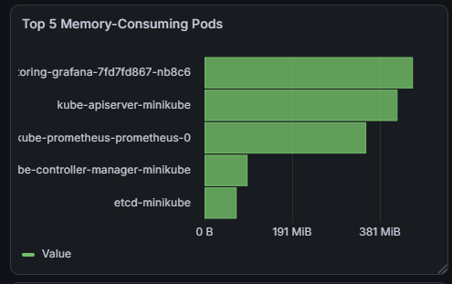

The captured dashboard screenshot shows the memory ranking, including workloads such as Grafana, kube-apiserver, Prometheus, controller-manager and etcd.

---

# 13. Dashboard Panel 10 — CPU Usage Over Time

## Purpose

Shows how CPU usage changes over the selected Grafana time range.

## Metric

```promql
container_cpu_usage_seconds_total
```

CPU is a counter, so the rate of change is used for time-series visualization.

A project query pattern used for CPU analysis was:

```promql
rate(
  container_cpu_usage_seconds_total[5m]
)
```

The dashboard groups the resulting CPU usage by namespace.

## Visualization

```text
Time series
```

## Screenshot

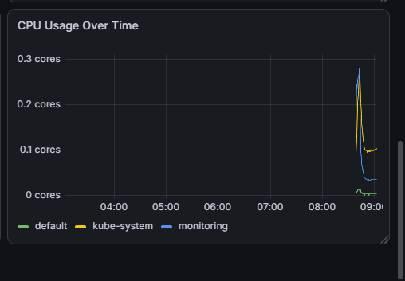

The panel makes it possible to identify changes, spikes and periods of increased CPU consumption.

---

# 14. Dashboard Panel 11 — Memory Usage Over Time

## Purpose

Shows memory usage over the selected Grafana time range.

## Metric

```promql
container_memory_working_set_bytes
```

The result is displayed as a time series so that memory behavior can be observed historically.

## Visualization

```text
Time series
```

## Screenshot

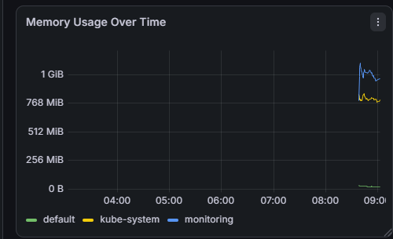

---

# 15. Dashboard Panel 12 — Node CPU Usage

## Purpose

Shows CPU utilization at the Kubernetes node level.

Node Exporter exposes CPU metrics such as:

```promql
node_cpu_seconds_total
```

This is a counter.

CPU utilization can be calculated from CPU idle time.

The project documentation used the following calculation:

```promql
100 -
(
  avg by (instance)
  (
    rate(node_cpu_seconds_total{mode="idle"}[5m])
  ) * 100
)
```

Conceptually:

```text
CPU Usage
    =
100% - CPU Idle%
```

## Visualization

```text
Time series
```

## Screenshot

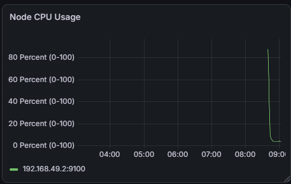

---

# 16. Dashboard Panel 13 — Network Traffic

## Purpose

Shows network receive traffic for Kubernetes nodes.

## Metric

```promql
node_network_receive_bytes_total
```

This is a counter containing cumulative received bytes.

Displaying the raw counter is not useful when we want current traffic rate.

Therefore we use:

```promql
rate()
```

## Final Network Query Used

```promql
sum(
  rate(
    node_network_receive_bytes_total{device!="lo"}[5m]
  )
) by (instance)
```

## Query Breakdown

```text
node_network_receive_bytes_total
            ↓
      cumulative bytes
            ↓
        rate(...[5m])
            ↓
     bytes per second
            ↓
      device!="lo"
            ↓
   exclude loopback traffic
            ↓
          sum()
            ↓
       by(instance)
            ↓
     traffic per node
```

## Why Exclude `lo`?

Linux has a loopback interface:

```text
lo
```

It represents local traffic inside the machine.

For a node network dashboard, the goal is to focus on actual network interfaces.

Therefore:

```promql
{device!="lo"}
```

is used.

## Visualization

```text
Time series
```

## Screenshot

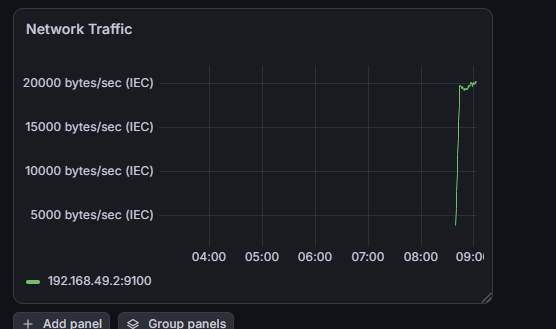

---

# 17. Final Dashboard

The dashboard brings the Kubernetes views together into one place.

Dashboard:

```text
Kubernetes Cluster Monitoring
```

The captured dashboard contains the Pod-count panels and namespace-based monitoring panels and was built manually from Prometheus metrics.

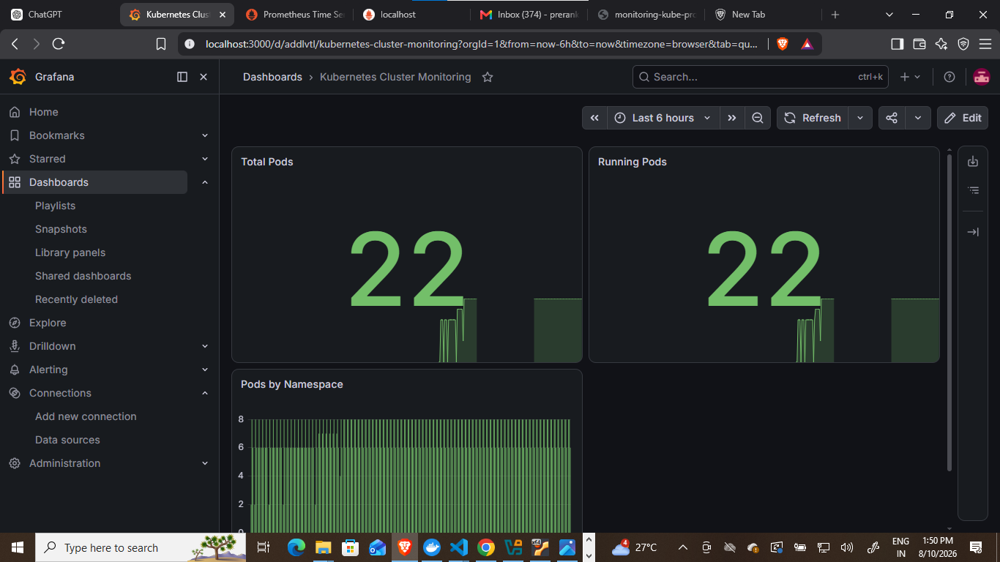

The dashboard time range used in the captured screenshots was:

```text
Last 6 hours
```

---

# 18. Dashboard Time Range

Grafana allows the user to select the period represented by the dashboard.

Examples:

```text
Last 5 minutes
Last 15 minutes
Last 1 hour
Last 6 hours
Last 24 hours
```

The selected range affects time-series panels such as:

- CPU Usage Over Time
- Memory Usage Over Time
- Network Traffic
- Node CPU Usage

---

# 19. Dashboard Refresh

Grafana dashboards can refresh automatically.

Common intervals include:

```text
5s
10s
30s
1m
5m
```

A shorter interval provides more current information but increases query frequency.

---

# 20. Grafana Variables

Dashboard variables allow the same dashboard to be reused for different Kubernetes values.

For example, instead of hard-coding:

```promql
namespace="default"
```

a dashboard can expose a namespace selector.

Conceptually:

```text
Dashboard Variable
        ↓
Selected Namespace
        ↓
PromQL
        ↓
Panel
```

This becomes useful when the dashboard is used with multiple namespaces or environments.

---

# 21. Grafana Alerting Integration

Dashboard visualization is only one part of monitoring.

The project also configured Grafana Alerting and email notifications.

The workflow was:

```text
Prometheus / Grafana Query
        ↓
Alert Rule
        ↓
Evaluation
        ↓
Contact Point
        ↓
Gmail
```

The project included Kubernetes alert scenarios such as:

```text
KubernetesPodNotReady
```

and the earlier Prometheus alerting work also covered:

```text
KubernetesPodOOMKilled
```

---

# 22. Grafana Alert Rule — Pod Not Ready

The Kubernetes Pod Not Ready rule used:

```promql
kube_pod_status_ready{
  condition="false",
  namespace!~"kube-system|monitoring"
} == 1
```

The rule was configured with:

```text
For: 1m
Severity: warning
```

The rule annotations included:

```text
Summary:
Pod Not Ready

Description:
Pod {{ $labels.pod }} in namespace {{ $labels.namespace }} is not ready.
```

The alert was tested with Pods such as:

```text
oom-demo
not-ready-demo
```

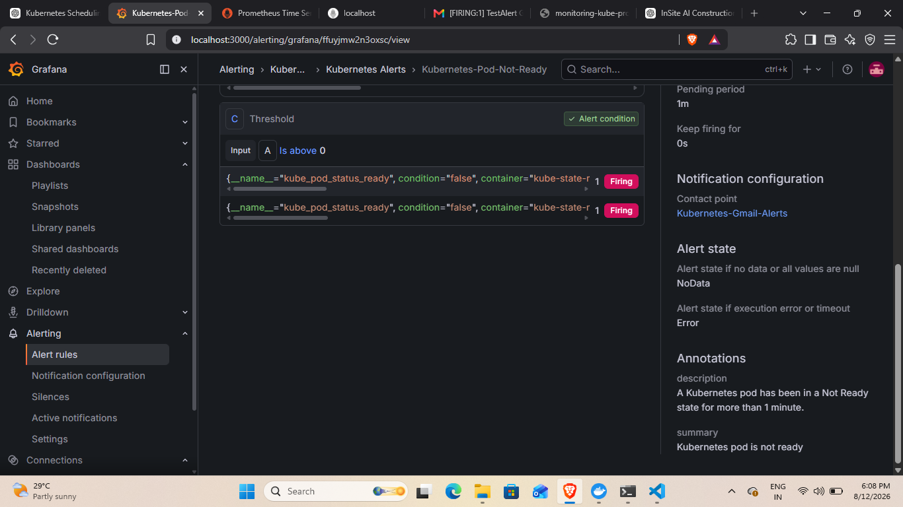

---

# 23. Grafana Notification Configuration

The project configured an email notification/contact point for Grafana alerts.

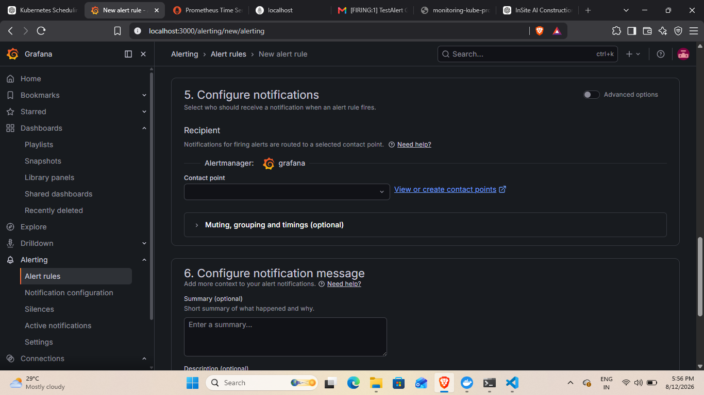

The alerting workflow was tested rather than only configured.

---

# 24. Gmail Alert Notification

The Grafana alert was successfully delivered through Gmail during testing.

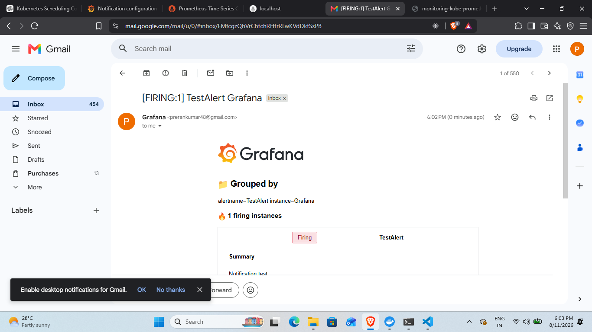

The project also tested the firing and resolved states.

---

# 25. Alerting and Dashboard Relationship

The dashboard and alerting systems serve different purposes.

### Dashboard

Answers:

> "What is happening right now?"

Examples:

- How many Pods are running?
- Which namespace is consuming CPU?
- Which Pods are using the most memory?
- Is network traffic increasing?

### Alerting

Answers:

> "Does something require attention?"

Examples:

- Pod is not ready.
- Container was OOMKilled.
- A target is down.
- Resource usage crosses a configured condition.

The complete monitoring flow is:

```text
Metrics
   ↓
Prometheus
   ↓
PromQL
   ├──────────────→ Grafana Dashboard
   │
   └──────────────→ Alert Rule
                         ↓
                    Notification
                         ↓
                       Gmail
```

---

# 26. Practical PromQL Used by the Dashboard

| Requirement | PromQL / Metric |
|---|---|
| Total Pods | `count(kube_pod_info)` |
| Running Pods | `kube_pod_status_phase{phase="Running"}` |
| Pod Ready | `kube_pod_status_ready` |
| Pod Not Ready | `kube_pod_status_ready{condition="false"} == 1` |
| Pod Restarts | `kube_pod_container_status_restarts_total` |
| Restart increase | `increase(kube_pod_container_status_restarts_total[5m])` |
| CPU | `container_cpu_usage_seconds_total` |
| CPU rate | `rate(container_cpu_usage_seconds_total[5m])` |
| CPU by namespace | `sum(rate(container_cpu_usage_seconds_total[5m])) by (namespace)` |
| Memory | `container_memory_working_set_bytes` |
| Node CPU | `node_cpu_seconds_total` |
| Network receive | `node_network_receive_bytes_total` |
| Network traffic | `sum(rate(node_network_receive_bytes_total{device!="lo"}[5m])) by (instance)` |

---

# 27. Troubleshooting Learned During Dashboard Creation

## 27.1 No Data

A `No data` result does not automatically mean that Prometheus is broken.

Possible causes include:

```text
Metric does not exist
Wrong metric name
Wrong label name
Wrong label value
Exporter does not expose the metric
Selected time range has no samples
Wrong metric type
Metric belongs to another exporter
```

---

## 27.2 Troubleshooting Process

When a query returns no data, build it gradually.

### Step 1 — Check the metric

```promql
node_network_receive_bytes_total
```

### Step 2 — Inspect labels

Look for labels such as:

```text
instance
job
device
namespace
pod
container
```

### Step 3 — Add filters

```promql
node_network_receive_bytes_total{device!="lo"}
```

### Step 4 — Add rate

```promql
rate(
  node_network_receive_bytes_total{device!="lo"}[5m]
)
```

### Step 5 — Aggregate

```promql
sum(
  rate(
    node_network_receive_bytes_total{device!="lo"}[5m]
  )
) by (instance)
```

This incremental approach makes PromQL troubleshooting much easier.

---

# 28. Counter vs Gauge — Important Dashboard Lesson

Before choosing a PromQL function, identify the metric type.

### Counter

Continuously increases, except when reset.

Examples:

```text
container_cpu_usage_seconds_total
node_cpu_seconds_total
node_network_receive_bytes_total
kube_pod_container_status_restarts_total
```

Common functions:

```text
rate()
increase()
```

### Gauge

Can increase and decrease.

Examples include current resource values.

The important practical lesson is:

```text
Metric type
    ↓
Choose the correct PromQL function
    ↓
Build the panel
```

---

# 29. Instant Query vs Range Query

### Instant Query

Evaluates the expression at one point in time.

Useful for:

```text
Current Pod status
Current target status
Current resource value
Alert condition testing
```

Example:

```promql
up
```

### Range Query

Evaluates the expression repeatedly across a time range.

Useful for:

```text
CPU usage over time
Memory usage over time
Network traffic over time
Historical analysis
```

Example:

```promql
rate(node_network_receive_bytes_total[5m])
```

Grafana time-series panels use range data to draw the historical graph.

---

# 30. Dashboard Design Lessons

A useful Kubernetes dashboard should answer operational questions quickly.

### Pod health

```text
Total Pods
Running Pods
Pod Ready Status
Pod Restart Count
```

### Resource usage

```text
CPU by Namespace
Memory by Namespace
Top CPU Pods
Top Memory Pods
```

### Historical behavior

```text
CPU Over Time
Memory Over Time
Network Traffic
Node CPU
```

This gives both a current-state view and a historical troubleshooting view.

---

# 31. Project Structure

The recommended Module 09 structure is:

```text
prometheus-grafana/
│
├── 01-monitoring-fundamentals.md
├── 02-prometheus-architecture.md
├── 03-prometheus-installation.md
├── 04-prometheus-ui-overview.md
├── 05-promql-fundamentals.md
├── 06-prometheus-alerting.md
├── 07-kubernetes-alert-rules.md
├── 08-grafana.md
│
├── 09-grafana-kubernetes-dashboard/
│   ├── 09-grafana-kubernetes-dashboard.md
│   │
│   └── images/
│       ├── 01-dashboard-overview.png
│       ├── 02-total-pods.png
│       ├── 03-running-pods.png
│       ├── 04-pods-by-namespace.png
│       ├── 05-pod-ready-status.png
│       ├── 06-pod-restart-count.png
│       ├── 07-cpu-by-namespace.png
│       ├── 08-memory-by-namespace.png
│       ├── 09-top-cpu-pods.png
│       ├── 10-top-memory-pods.png
│       ├── 11-cpu-over-time.png
│       ├── 12-memory-over-time.png
│       ├── 13-node-cpu.png
│       ├── 14-network-traffic.png
│       ├── 15-prometheus-datasource-test.png
│       ├── 16-grafana-alert-rule.png
│       ├── 17-grafana-notification-config.png
│       └── 18-gmail-alert.png
│
├── alert-rules/
├── screenshots/
├── diagrams/
├── alertmanager-values.yaml
├── grafana-smtp.yaml
└── README.md
```

The Module 09 images are kept inside the module directory so the documentation is self-contained.

---

# 32. What Belongs in Which Module?

To avoid duplicating the project documentation:

## Module 05 — PromQL Fundamentals

Focus on:

```text
PromQL syntax
Metrics
Labels
Filtering
Aggregation
rate()
increase()
Kubernetes metrics
Troubleshooting PromQL
```

## Module 06 — Prometheus Alerting

Focus on:

```text
Prometheus alert rules
Alert states
Alert evaluation
Alertmanager
Notification flow
```

## Module 07 — Kubernetes Alert Rules

Focus on practical Kubernetes alert scenarios:

```text
CPU
Memory
Disk
Image Pull
Pod Restart
OOMKilled
Pod Not Ready
```

## Module 08 — Grafana

Focus on Grafana fundamentals:

```text
Grafana installation
Grafana UI
Data sources
Explore
Grafana concepts
Alerting concepts
```

## Module 09 — Grafana Kubernetes Dashboard

Focus on:

```text
Actual dashboard
Actual Kubernetes panels
PromQL used by panels
Panel visualization
Panel troubleshooting
Dashboard organization
Dashboard variables
Dashboard time range
Grafana alert integration
Gmail notification test
```

This prevents Module 09 from becoming another copy of the PromQL module.

---

# 33. Final Monitoring Architecture

```text
                    Kubernetes Cluster
                           │
             ┌─────────────┴─────────────┐
             │                           │
       kube-state-metrics          node-exporter
             │                           │
             └─────────────┬─────────────┘
                           │
                           ▼
                      Prometheus
                           │
                     PromQL Queries
                           │
                           ▼
                       Grafana
                           │
          ┌────────────────┴────────────────┐
          │                                 │
          ▼                                 ▼
   Kubernetes Dashboard              Grafana Alerting
          │                                 │
          │                                 ▼
          │                           Contact Point
          │                                 │
          │                                 ▼
          │                              Gmail
          │
          ├── Total Pods
          ├── Running Pods
          ├── Pods by Namespace
          ├── Pod Ready Status
          ├── Pod Restart Count
          ├── CPU by Namespace
          ├── Memory by Namespace
          ├── Top CPU Pods
          ├── Top Memory Pods
          ├── CPU Over Time
          ├── Memory Over Time
          ├── Node CPU
          └── Network Traffic
```

---

# 34. Key Takeaways

The most important practical lessons from this module are:

1. Grafana does not replace Prometheus; it visualizes data retrieved from Prometheus.
2. Prometheus is the Grafana data source in this project.
3. kube-state-metrics provides Kubernetes object metrics such as Pod information and status.
4. node-exporter provides node-level metrics such as CPU and network statistics.
5. PromQL is the bridge between collected metrics and Grafana panels.
6. Counters generally need functions such as `rate()` or `increase()` when measuring activity over time.
7. Labels allow metrics to be grouped by namespace, Pod, node and other dimensions.
8. A dashboard should answer operational questions rather than simply display as many graphs as possible.
9. Grafana dashboards provide visibility; alerting provides notification when attention is required.
10. The best troubleshooting method is to start with a simple metric and gradually build the final query.

---

# 35. Interview Explanation

If asked:

> **How did you implement Kubernetes monitoring using Prometheus and Grafana?**

A practical answer is:

> I deployed Prometheus and Grafana using the kube-prometheus-stack in my Kubernetes environment. kube-state-metrics provided Kubernetes object metrics and node-exporter provided node-level metrics. I configured Prometheus as the Grafana data source and verified the integration using queries such as `up`, `kube_pod_info`, and `count(kube_pod_info)`. I then created a Kubernetes monitoring dashboard manually using PromQL, with panels for Pod count, Running Pods, Pods by Namespace, Pod readiness, restart count, CPU and memory usage, top resource-consuming Pods, CPU and memory trends, node CPU and network traffic. I also configured Grafana alerting and email notifications and tested Kubernetes Pod Not Ready alerts through Gmail.

---

## End of Module 09

The dashboard is now the visualization layer connecting the Prometheus metrics and PromQL work from the earlier modules with practical Kubernetes monitoring and alerting.
